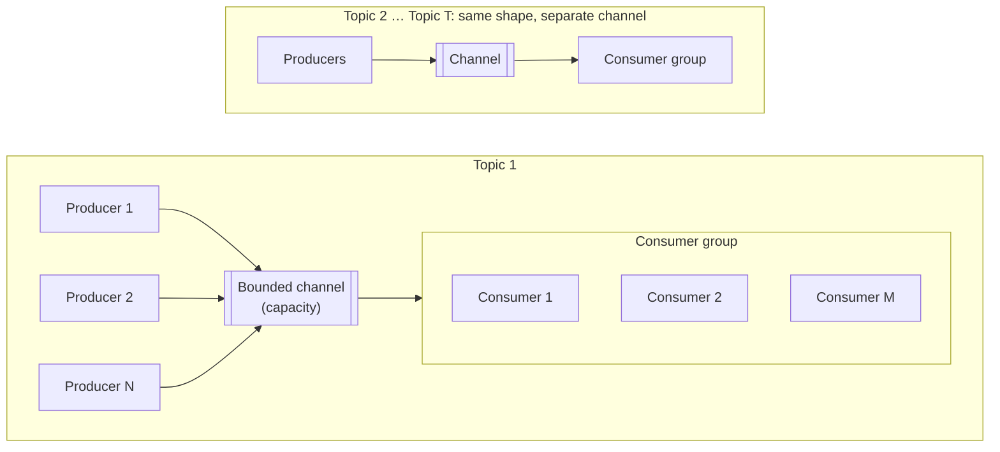
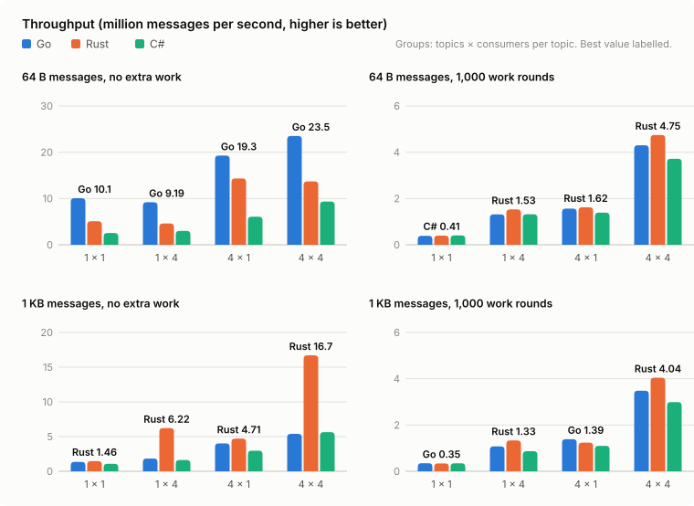
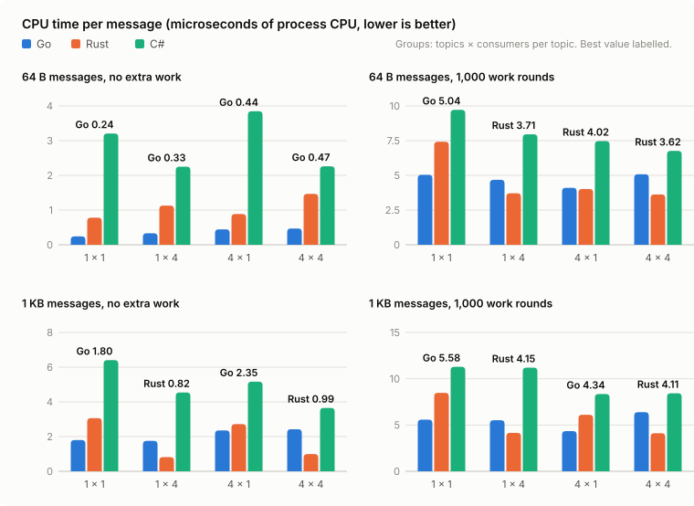
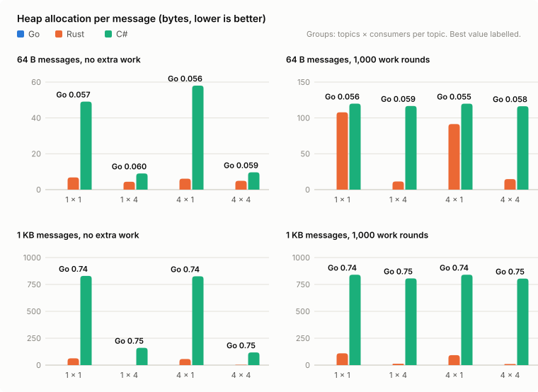

# Cross-language async channel benchmark

A reproducible benchmark of bounded in-process channels in Go, C# and Rust, shaped like a small message broker: messages go to topics, and each topic has one consumer group that does real work on every message. It measures three things per message: throughput, CPU time and heap allocation.

| Language | Channel | Benchmark library |
|---|---|---|
| Go | native `chan` (goroutines block on send and receive) | `testing` (`go test -bench`) |
| C# | `System.Threading.Channels` bounded channel, async `WriteAsync` and `ReadAllAsync` | BenchmarkDotNet |
| Rust | `async-channel` bounded channel on the tokio multi-thread runtime | Criterion |

Rust uses `async-channel` instead of `tokio::sync::mpsc` because a consumer group needs several consumers reading one channel, and tokio's `mpsc` allows only one receiver.

## What one operation does



Each message goes to exactly one consumer in its topic's group, which hashes the payload and runs the simulated work.

- **Topics.** Each topic gets its own bounded channel. Topics share nothing except the CPU.
- **Producers.** Each topic has the same number of producers. Together they send sequence numbers `0` to `messages - 1` to the topic, each producer taking every Nth number.
- **Consumer group.** Each topic has one consumer group. Its consumers compete for the topic's messages, so every message is processed by exactly one consumer in the group, as with a Kafka consumer group. Adding consumers spreads the processing, not the delivery.
- **Payload.** A message is a fixed-size value of 8, 64, 256 or 1024 bytes, copied through the channel with no per-message allocation. It holds padding words followed by the sequence number.
- **Simulated work.** For each message, the consumer hashes every 8-byte word of the payload, then runs `work` more hash rounds. Each round is the SplitMix64 finalizer, a few nanoseconds of CPU. `work = 0` leaves only the payload hash, so larger payloads cost more to process, as they would in practice.
- **Correctness.** Every operation checks that the sequence numbers summed across all consumers match the expected total. Each language's tests also check that a run's combined hash digest matches a sequential reference. All three pin the same reference digest, which proves they do identical work per message.

One operation sends `messages` messages to every topic, so it moves `messages × topics` messages in total. Timings include starting and stopping the producers and consumers, amortized over the batch.

## Quick start

Requires Go 1.22+, .NET SDK 10+, Rust/Cargo, Node.js (to redraw the charts) and PowerShell 7+ for the script.

```powershell
./run.ps1
```

The script runs each language's correctness checks, then the three benchmark suites over the same matrix, and writes `out/results.csv` with one row per language and case:

```text
language,payload_bytes,capacity,topics,producers_per_topic,consumers_per_topic,work_rounds,messages_per_topic,median_ns_per_msg,msg_per_second,cpu_ns_per_msg,alloc_bytes_per_msg
```

What each metric means and how it is measured:

| Column | Meaning | Go | Rust | C# |
|---|---|---|---|---|
| `median_ns_per_msg`, `msg_per_second` | Wall-clock time per message | `testing` ns/op, median of `-GoCount` runs | Criterion median | BenchmarkDotNet median |
| `cpu_ns_per_msg` | Process CPU time (user plus kernel, all threads) per message. Shows cost that wall time hides: idle threads spinning, scheduling and garbage collection. | Measured over the timed operations | Separate pass after timing | Separate pass after timing |
| `alloc_bytes_per_msg` | Heap bytes allocated per message, including per-operation setup such as channels and tasks | `testing` B/op (`b.ReportAllocs`) | Counting global allocator | `GC.GetTotalAllocatedBytes` (managed heap) |

Each per-message figure is the per-operation figure divided by `messages × topics`. The separate pass for Rust and C# runs the case for at least 3 operations and 1 second after the library has finished timing it, so warm-up is excluded.

To redraw the charts and print the winner table from a results file:

```powershell
node scripts/charts.mjs out/results.csv docs/charts
```

Every dimension is a parameter:

| Parameter | Default | Meaning |
|---|---|---|
| `-Messages` | `100000` | Messages sent to each topic per operation |
| `-Payloads` | `64,1024` | Message sizes in bytes: any of 8, 64, 256, 1024 |
| `-Capacities` | `64` | Bounded capacity of each topic's channel (at least 1) |
| `-Topics` | `1,4` | Number of topics |
| `-Producers` | `4` | Producers per topic |
| `-Consumers` | `1,4` | Consumers in each topic's consumer group |
| `-Work` | `0,1000` | Extra hash rounds per message |
| `-GoCount` | `5` | Go benchmark runs per case |

The benchmark runs every combination, so the matrix grows quickly. The defaults (16 cases per language) took about 13 minutes on the machine in [Sample results](#sample-results). For example:

```powershell
./run.ps1 -Payloads 8,64,256,1024 -Capacities 1,64,1024 -Topics 1 -Consumers 1,2,4,8 -Work 0
```

## Running one language

Each suite reads the same matrix from environment variables: `BENCH_MESSAGES`, `BENCH_PAYLOADS`, `BENCH_CAPACITIES`, `BENCH_TOPICS`, `BENCH_PRODUCERS`, `BENCH_CONSUMERS` and `BENCH_WORK`, with comma-separated values and the defaults above. Go prints CPU time and allocation with its results. Rust and C# append them to the CSV file named by `BENCH_RESOURCES_OUT`, if set, as `case,operations,cpu_ns,allocated_bytes`.

```powershell
$env:BENCH_PAYLOADS = '1024'; $env:BENCH_CONSUMERS = '1,2,4,8'

go -C go test -run . -count 1                                  # correctness checks
go -C go test -run '^$' -bench BenchmarkChannel -benchtime 2s  # benchmarks

cargo test --release --manifest-path rust/Cargo.toml
cargo bench --manifest-path rust/Cargo.toml --bench channel

dotnet run -c Release --project csharp -- --verify
dotnet run -c Release --project csharp
```

Criterion writes HTML reports to `rust/target/criterion/`. BenchmarkDotNet writes reports to `BenchmarkDotNet.Artifacts/`, or to `out/bdn/` when started by `run.ps1`. BenchmarkDotNet's own command-line options, such as `--job short` for a quick pass, can follow the `--`.

## Code layout

| Path | Contents |
|---|---|
| `go/channel.go` | Message type, simulated work, `Run` and the sequential `Expected` reference |
| `go/channel_test.go` | Correctness tests and `BenchmarkChannel` |
| `go/cpu_*_test.go` | Process CPU time on Windows and on Unix |
| `rust/src/lib.rs` | The same for Rust, with unit tests |
| `rust/benches/channel.rs` | Criterion benchmark |
| `csharp/Channel.cs` | The same for C# |
| `csharp/Program.cs` | BenchmarkDotNet benchmark class and the `--verify` checks |
| `run.ps1` | Runs everything and writes `out/results.csv` |
| `scripts/charts.mjs` | Draws the charts in `docs/charts/` and prints the winner table |
| `docs/results.csv` | The results behind [Sample results](#sample-results) |

## Reading the results

Run on an idle machine and compare medians, not single runs. These are throughput numbers, not latency percentiles. Go's blocking goroutines, .NET's thread-pool continuations and tokio's work-stealing tasks schedule differently, and Rust here uses a different channel crate than the tokio default. The results compare these channels under this workload on the tested machine. They are not a general ranking of channel implementations.


## Sample results

One run of `./run.ps1` with its defaults, recorded 2026-10-14: capacity 64, 4 producers per topic, 100,000 messages per topic per operation, 16 cases per language. Every correctness check passed before the benchmarks ran, and every operation's sequence checksum matched. The data is in [docs/results.csv](docs/results.csv).

### Winners

| Category | Winner | Margin | Cases won |
|---|---|---|---|
| **Throughput** (messages per second) | **Rust** | 6% ahead of Go | 9 of 16 |
| **CPU time** per message | **Go** | 21% ahead of Rust | 9 of 16 |
| **Heap allocation** per message | **Go** | 81× less than Rust | 16 of 16 |

The winner in each category has the best geometric mean of its per-case ratio to the best language in that case. The margin compares the winner's mean with the runner-up's. C# came last in all three: it won one throughput case, by 3% in a case where all three were within 5%, and it used the most CPU and allocated the most memory in every one of the 16 cases.

The winner changes with the workload:

| Category | 64 B messages | 1 KB messages | No extra work | 1,000 work rounds |
|---|---|---|---|---|
| Throughput | **Go**, 27% ahead of Rust; won 4 of 8 | **Rust**, 42% ahead of Go; won 6 of 8 | **Rust**, 5% ahead of Go (close); won 4 of 8 | **Rust**, 7% ahead of Go; won 5 of 8 |
| CPU time | **Go**, 65% ahead of Rust; won 5 of 8 | **Rust**, 13% ahead of Go; won 4 of 8 | **Go**, 50% ahead of Rust; won 6 of 8 | **Rust**, 2% ahead of Go (close); won 5 of 8 |
| Heap allocation | **Go**, 244× less than Rust; won 8 of 8 | **Go**, 27× less than Rust; won 8 of 8 | **Go**, 39× less than Rust; won 8 of 8 | **Go**, 169× less than Rust; won 8 of 8 |

In short: **Go** wins with small messages and light processing, and allocates almost nothing in every case. **Rust** wins with 1 KB messages and with several consumers doing heavy work. **C#** does not win a category.

### Charts

Each chart has one panel per payload size and work level. Within a panel, each group is one topics × consumers-per-topic combination, and the best value is labelled.

<picture>
  <source media="(prefers-color-scheme: dark)" srcset="docs/charts/throughput-dark.svg">
  
</picture>

<picture>
  <source media="(prefers-color-scheme: dark)" srcset="docs/charts/cpu-dark.svg">
  
</picture>

<picture>
  <source media="(prefers-color-scheme: dark)" srcset="docs/charts/alloc-dark.svg">
  
</picture>

### Observations

- **Throughput, small messages:** Go was fastest in all four 64-byte cases without extra work, by 1.3–2× over Rust and 2.5–4× over C#.
- **Throughput, large messages:** Rust was fastest in 6 of 8 1 KB cases. With 4 consumers per topic and no extra work, it was 3–4× faster than Go and C# (with 4 topics, 16.7M against 5.4M and 5.6M messages per second). A likely cause, not measured here: Go channels and .NET's bounded channel copy each element while holding the channel's lock, which serializes 1 KB copies; `async-channel`'s lock-free queue does not.
- **Consumer groups spread the work:** with 64-byte messages, 1,000 work rounds and one topic, going from 1 to 4 consumers multiplied throughput by 3.4× in Go, 3.9× in Rust and 3.3× in C#.
- **CPU:** C# used 1.9–13× more CPU per message than the winner in every case. With one 64-byte consumer and no extra work, it kept about 8 cores busy (3.21 µs of CPU per 0.39 µs of wall time) where Go kept about 2.4 busy. That points to idle thread-pool threads spinning, but this run doesn't prove it. Go used the least CPU in all four 64-byte cases without extra work. Rust used the least in all six cases with 4 consumers per topic and either 1 KB messages or extra work.
- **Allocation:** Go allocated about 0.06 bytes per message for 64-byte messages and 0.75 bytes for 1 KB messages. That's the per-operation setup (channels and goroutines) spread over 100,000 messages: Go channels allocate nothing per message. Rust and C# allocated more, mostly when producers had to wait for a slow consumer group. With one consumer and 1,000 work rounds, Rust allocated about 108 bytes per message; with four consumers, about 11. C# allocated 800 or more bytes per 1 KB message in six of the eight 1 KB cases, and 118–160 bytes in the two where four consumers per topic kept up without extra work. A likely cause, not measured here: `async-channel` allocates a listener each time a sender waits, and .NET allocates a pending-write operation, which holds the 1 KB message, for each write that waits.
- **Stability:** Go's five runs per case stayed within 12% of each other in all but one case: 1 KB messages, 4 topics with one consumer each, and heavy work, which spread 32%.

### All numbers

<details>
<summary>Throughput, CPU time and allocation for every case (best in bold)</summary>

M/s is million messages per second. CPU µs is process CPU time per message in microseconds. B is heap bytes allocated per message.

| 64 B | 1 × 1 | 0 | **10.1** | 5.09 | 2.53 | **0.24** | 0.78 | 3.21 | **0.057** | 6.81 | 49.1 |
| 64 B | 1 × 4 | 0 | **9.19** | 4.60 | 3.00 | **0.33** | 1.13 | 2.25 | **0.06** | 4.40 | 9.02 |
| 64 B | 4 × 1 | 0 | **19.3** | 14.3 | 6.06 | **0.44** | 0.89 | 3.85 | **0.056** | 6.11 | 58.0 |
| 64 B | 4 × 4 | 0 | **23.5** | 13.7 | 9.34 | **0.47** | 1.47 | 2.26 | **0.059** | 4.91 | 9.66 |
| 64 B | 1 × 1 | 1,000 | 0.39 | 0.39 | **0.41** | **5.04** | 7.42 | 9.72 | **0.056** | 108 | 120 |
| 64 B | 1 × 4 | 1,000 | 1.31 | **1.53** | 1.32 | 4.68 | **3.71** | 7.96 | **0.059** | 11.4 | 117 |
| 64 B | 4 × 1 | 1,000 | 1.56 | **1.62** | 1.39 | 4.10 | **4.02** | 7.47 | **0.055** | 91.4 | 120 |
| 64 B | 4 × 4 | 1,000 | 4.30 | **4.75** | 3.72 | 5.08 | **3.62** | 6.76 | **0.058** | 14.7 | 116 |
| 1 KB | 1 × 1 | 0 | 1.35 | **1.46** | 1.08 | **1.80** | 3.06 | 6.41 | **0.74** | 63.0 | 829 |
| 1 KB | 1 × 4 | 0 | 1.84 | **6.22** | 1.62 | 1.75 | **0.82** | 4.54 | **0.75** | 1.67 | 160 |
| 1 KB | 4 × 1 | 0 | 4.02 | **4.71** | 2.97 | **2.35** | 2.72 | 5.17 | **0.74** | 56.8 | 826 |
| 1 KB | 4 × 4 | 0 | 5.39 | **16.7** | 5.64 | 2.42 | **0.99** | 3.65 | **0.75** | 3.30 | 118 |
| 1 KB | 1 × 1 | 1,000 | **0.35** | 0.34 | 0.35 | **5.58** | 8.48 | 11.3 | **0.74** | 110 | 840 |
| 1 KB | 1 × 4 | 1,000 | 1.08 | **1.33** | 0.87 | 5.52 | **4.15** | 11.2 | **0.75** | 12.5 | 806 |
| 1 KB | 4 × 1 | 1,000 | **1.39** | 1.24 | 1.10 | **4.34** | 6.11 | 8.35 | **0.74** | 92.7 | 840 |
| 1 KB | 4 × 4 | 1,000 | 3.48 | **4.04** | 2.99 | 6.38 | **4.11** | 8.43 | **0.75** | 10.2 | 805 |

</details>

### Environment

| | |
|---|---|
| CPU | Intel Core i9-13900K (24 cores, 32 threads) |
| Memory | 128 GB |
| OS | Windows 11 Enterprise 10.0.28000 |
| Go | 1.26.4, `testing` benchmarks, `-benchtime 2s -count 5` |
| .NET | 10.0.13 (SDK 10.0.402), concurrent workstation GC, BenchmarkDotNet 0.15.8 default job |
| Rust | rustc 1.96.0, tokio 1.53.3, async-channel 2.5.0, Criterion 0.5.1 (20 flat samples), cpu-time 1.0.0 |

The full run took about 13 minutes.

Limitations: one session on one machine, which was not verified to be idle. Each library chose its own iteration counts. Rust and C# measure CPU and allocation in a separate pass after timing, while Go measures them during its timed runs. Treat these numbers as an example of what the benchmark reports, not as a general ranking (see [Reading the results](#reading-the-results)). Your results will differ with hardware, OS and toolchain versions.